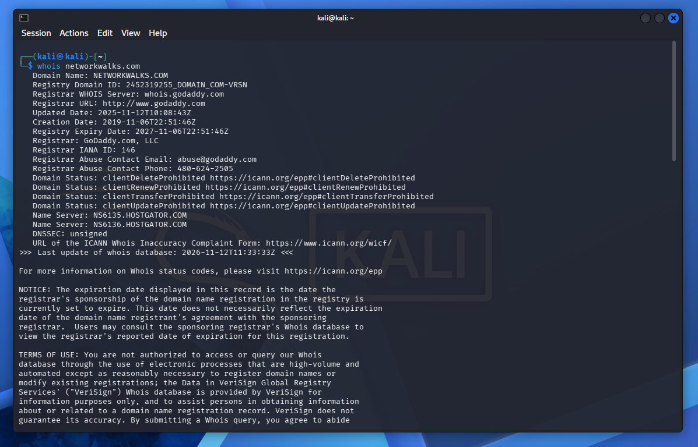
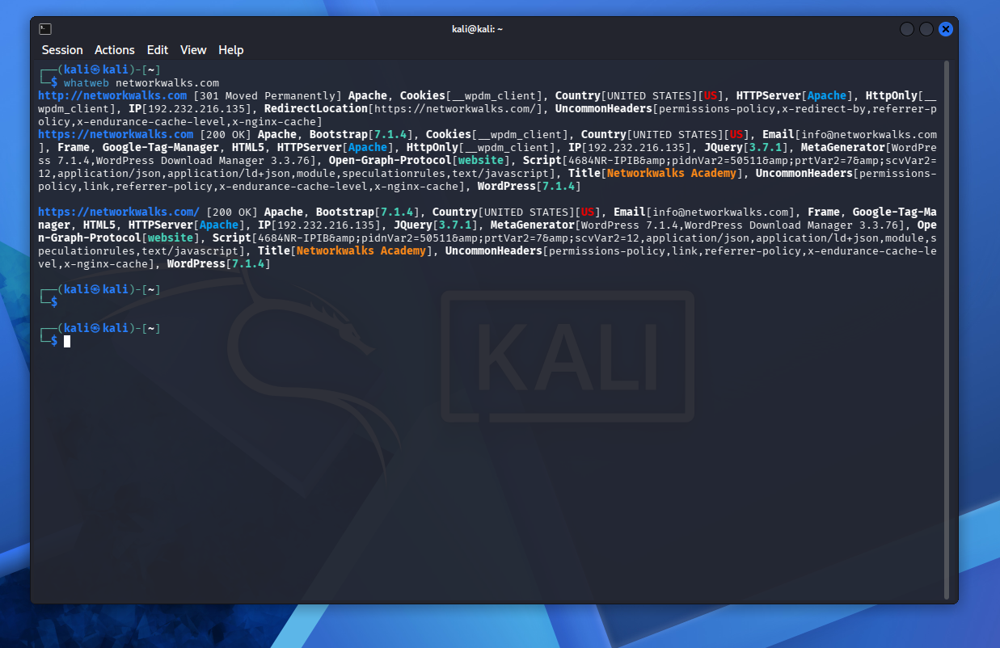
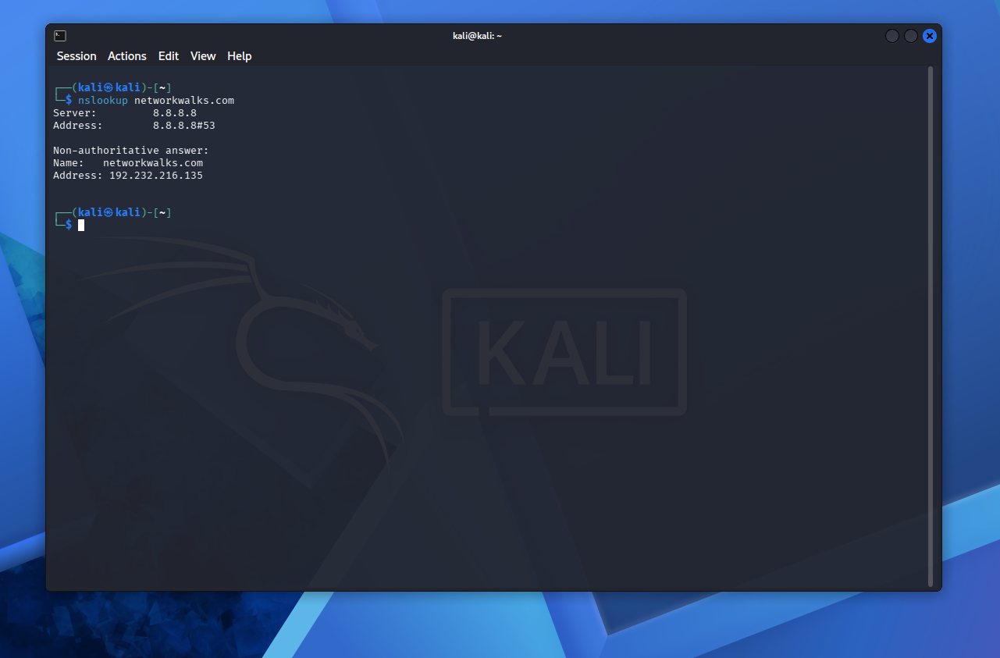
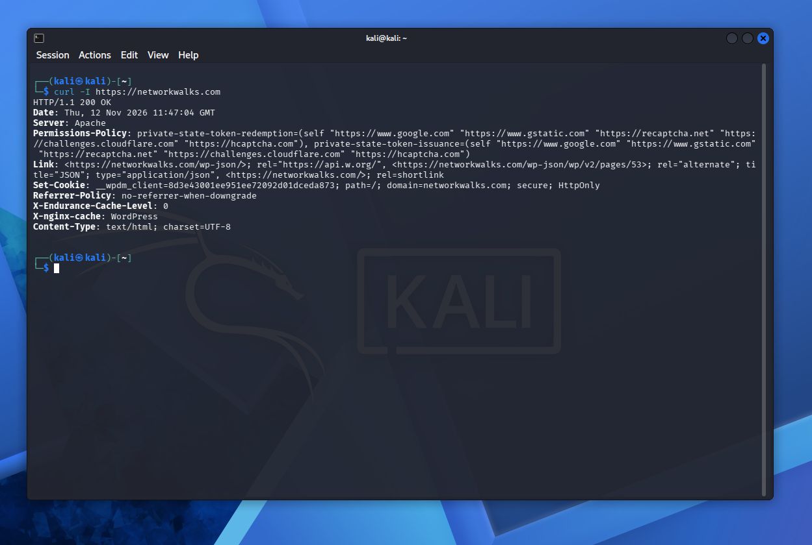
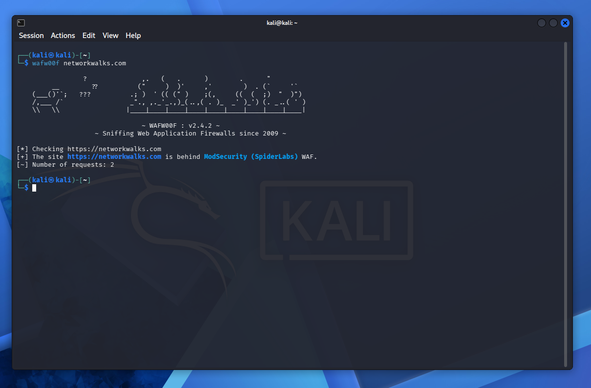
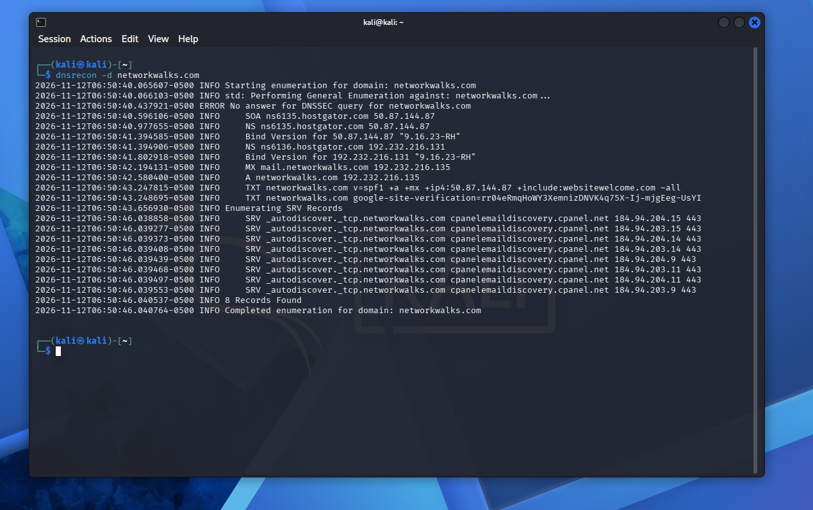
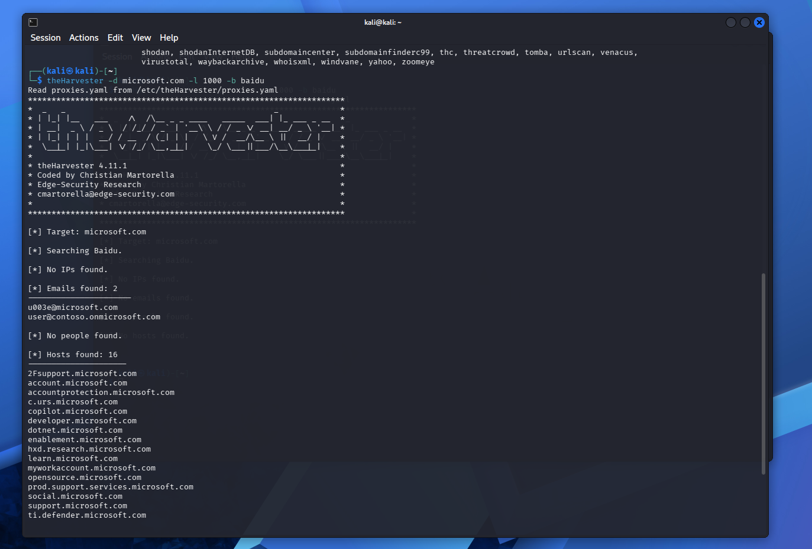
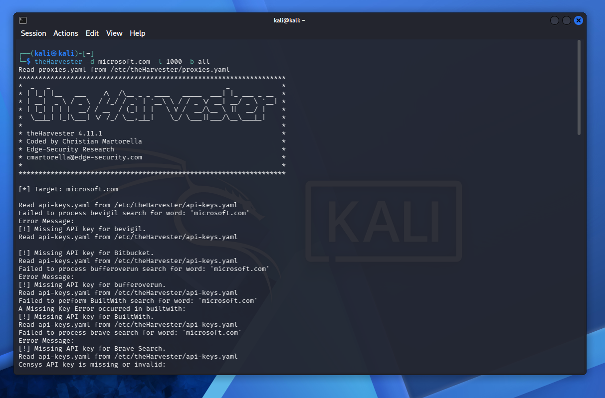
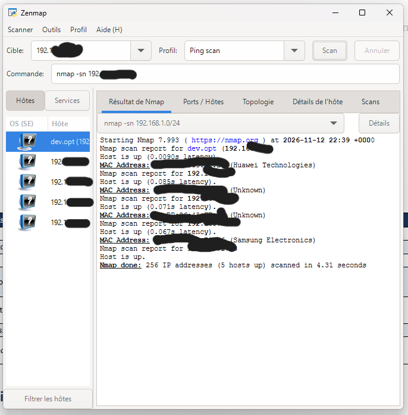
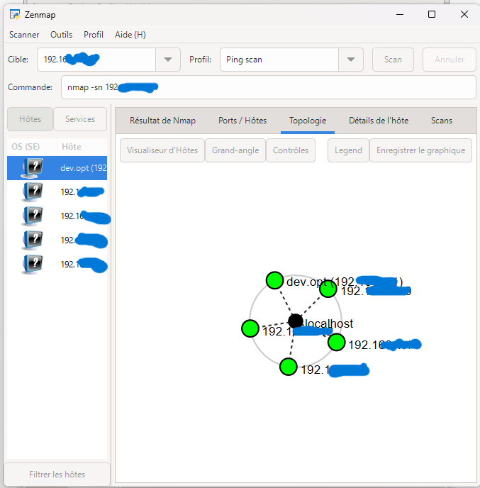

# week2-project-cybersecurity-with-networkwalks-B084-penetration-testing
# PENETRATION TESTING REPORT
## FOOTPRINTING AND NETWORK SCANNING
## W2-PM-FINAL  |  CYBERSECURITY  |  NETWORKWALKS

Report/details	| Information
---|---
Pentester	| Touab Hajar (Cybersecurity Student)
Program / Batch	| B084 – Networkwalks
Date	| 13 November 2026
Completed modules	| W2-PM1 – Multiple Kali Tools / W2-PM5 – Zenmap Scanning / W2-PM4 – Footp with theHarvester
Client / Target	| 1. Networkwalks (written authorization obtained) / 2. Personal local LAN
Client permission obtained?	| Yes
Phases covered	| Phase 1: Reconnaissance and Footprinting / Phase 2: Scanning and Network Discovery

## 1. Liability Disclaimer
All activities described in this report were carried out only on systems and devices for which written authorization had been obtained, or on equipment owned by me. The work is intended solely for educational and research purposes. The techniques and information presented must not be used for unlawful activities. Any misuse of this knowledge is the responsibility of the individual performing it. Unauthorized access may constitute a criminal offence, even when no damage is caused, and may result in legal penalties, financial fines, or professional consequences. The instructor, authors, and Networkwalks accept no responsibility for misuse of the material.

## 2. Introduction
This report documents two practical activities completed during Week 2 of my internship program at Networkwalks. The first activity (W2-PM1) involved gathering publicly available information about the networkwalks.com domain with several Kali Linux tools. The second activity (W2-PM5) focused on discovering devices on my own local network using Zenmap.
Together, these exercises demonstrate two important stages of a security assessment: collecting information about a target and identifying active devices within a network. Footprinting was conducted in Kali Linux, while the network-scanning exercise was performed on a Windows computer running Zenmap. The report describes the tools used, the observations obtained, their potential security implications, and supporting evidence.

## 3. Tools Used
The following tools and operating environments were used during the two practical activities:

Tool	| Purpose
---|---
Kali Linux and Windows	| Operating systems used to perform the reconnaissance and scanning exercises.
WHOIS	| Retrieves publicly available domain-registration details, such as registration dates and name servers.
WhatWeb	| Identifies technologies used by a website, including its server, CMS, plugins, and related details.
nslookup	| Queries DNS to resolve a domain name to an IP address and retrieve DNS information.
curl -I	| Retrieves HTTP response headers from a website.
Wafw00f	| Checks whether a website is protected by a Web Application Firewall (WAF).
DNSRecon	| Enumerates DNS information, including NS, MX, SPF, TXT, and SRV records.
Zenmap (Nmap GUI)	| Scans a local subnet to discover active hosts and, where available, their IP and MAC addresses.
Windows Command Prompt	| Used to identify local network configuration and IP/MAC information.
the Harvester  	| Used for gathering information of emails, sub-domains, hosts for different public sources like search engines.

## 4. Activities Performed
### 4.1 Footprinting and Reconnaissance
I carried out reconnaissance on the networkwalks.com domain using six tools available in Kali Linux: WHOIS, WhatWeb, nslookup, curl, Wafw00f, and DNSRecon. Each tool was selected to collect a different category of information about the target.
First, WHOIS was used to retrieve publicly accessible domain-registration information and identify the domain name servers. This information provided an overview of the domain registration and aspects of its hosting infrastructure.
Next, whatweb was used to fingerprint the website and identify its underlying technologies. The scan reported WordPress version 7.1.4 and WP Download Manager version 3.3.78, in addition to other information exposed by the website.
The nslookup command was then used to resolve the domain name through DNS. The result returned the IP address 192.232.216.135.
After that, curl was executed with the -I option to retrieve the website’s HTTP response headers. The response provided technical details about the web application and revealed the WordPress REST API endpoint /wp-json/.
wafw00f was subsequently used to check whether a Web Application Firewall was present. The result identified ModSecurity (SpiderLabs) as the WAF technology.
Then, dnsrecon was used to enumerate DNS records. The collected information included name-server and mail-server details, SPF/TXT records, service records, and information about DNS software.
Finaly, I used theHarvester tool installed by default in Kali Linux to test extracting emails, sub-domains, hosts, employees names, open ports and banners from different public sources. The source I used is Baidu and the target was microsoft.com. I sarted theHarvester and run the command theHarvester –d microsoft.com –l 1000 –b baidu and the command theHarvester –d microsoft.com –l 50 –d all.

### 4.2 Network Scanning with Zenmap
The second practical exercise consisted of discovering devices on my own local network with Zenmap. The task involved identifying the computer’s local IP address and subnet, detecting active hosts, collecting IP and MAC address information, and generating a network topology.
I began by running the ipconfig command in the Windows Command Prompt to determine the local IP configuration and LAN subnet. I then entered the subnet in Zenmap and selected the Ping Scan profile to perform host discovery.
According to the example results recorded in the practical exercise, the scan detected 5 hosts. Once the scan was complete, I opened Zenmap’s Topology tab, enabled the legend, and exported the network topology as a PDF file, as requested in the practical instructions.

## 5. Risk Analysis and Potential Impact
The information gathered during the footprinting and network-scanning activities revealed several observations that could have security implications. The following table summarizes these findings and their potential impact:

No.	| Risk / Finding	| Evidence / Observation	| Potential Impact	| Level
---|---|---|---|---
1	| Website technology information is exposed	| WhatWeb identified WordPress and WP Download Manager.	| An attacker could use exposed technology and version details to identify software that may require additional security review.	| Medium
2	| The server IP address can be identified	| nslookup resolved the domain to 192.232.216.135.	| This reveals information about the network location of the web service.	| Low
3	| HTTP technical details are exposed	| curl returned HTTP response headers and revealed /wp-json/.	| The information may support technology fingerprinting and further enumeration.	| Low
4	| The WAF technology can be identified	| Wafw00f detected ModSecurity (SpiderLabs).	| This provides insight into the security architecture protecting the web application.	| Low
5	| DNS infrastructure details are available	| DNSRecon identified DNS, mail, and service-related records.	| DNS information may help build a broader picture of the target infrastructure.	| Medium
6	| Multiple live hosts are listed as visible on the local network	| The risk table in the source report records four live hosts in the example network.	| Unexpected or unauthorized devices could potentially be connected to the network and should be checked.	| Medium
7	| Publicly exposed email addresses	| theHarvester discovered 2 email-like addresses associated with the target domain	| Attackers could use valid or publicly exposed email addresses as starting points for phishing, social engineering or spam campaigns. However, the discovered addresses have not been verified.	| Low
8	| Subdomain and hostname disclosure	| The tool identified 16 hostnames, including account.microsoft.com, copilot.microsoft.com and support.microsoft.com.	| This information could help attackers map publicly visible services, identify potential entry points and plan further reconnaissance.	| Medium
9	| Limited IP address discovery	| No IP addresses were found in the Baidu search results	| The available information was insufficient to identify the target's IP addresses through this search source. Other reconnaissance techniques could reveal additional infrastructure details.	| Low
10	| Public information exposure	| The search revealed publicly indexed information related to Microsoft's domain and services.	| Attackers could combine these findings with information from other sources to build a more detailed profile of the organization's public-facing infrastructure.	| Low

Risk-level key: Critical – highest concern; Medium – moderate concern; Low – lower concern.
These items represent observations made during the footprinting and scanning exercises; they are not confirmed vulnerabilities. The practical work focused on information gathering and host discovery. No exploitation or vulnerability validation was carried out. Therefore, the disclosure of a software version, IP address, or DNS record does not, by itself, prove that a system is vulnerable. Additional security testing, conducted with proper authorization, would be necessary to verify any suspected weakness.

## 6. Recommendations
Based on the observations made during the exercises, the following measures are recommended:
1. Review publicly visible technology details: Regularly assess what information about web technologies, content-management systems, and plugins is exposed to the public.
2. Keep software and plugins up to date: Update CMS platforms, plugins, and other web components regularly, and review them against relevant security advisories.
3. Examine HTTP response headers: Check HTTP headers to identify and reduce the disclosure of unnecessary technical information.
4. Audit DNS records periodically: Review DNS records to ensure that only necessary information and services are publicly accessible.
5. Configure and monitor the WAF appropriately: Keep ModSecurity enabled, maintain its configuration, and monitor its effectiveness.
6. Conduct regular internal network discovery: Scan internally managed networks at appropriate intervals to maintain visibility over connected devices.
7. Investigate unfamiliar devices: Verify any unexpected devices identified during network discovery and determine whether they are authorized.
8. Keep network documentation current: Maintain accurate records of network topology, devices, and relevant configuration details.
9. Ensure all security testing is authorized: Perform reconnaissance and scanning only within an explicitly approved scope and with the required permission.

## 7. Conclusion
During the second week of my Cybersecurity and Ethical Hacking internship, I completed practical exercises covering footprinting, reconnaissance, and network scanning.
For the footprinting activity, I used six Kali Linux tools to collect information about the target domain. Through these exercises, I learned that WHOIS can reveal domain-registration information, WhatWeb can identify website technologies, nslookup can resolve domain names, curl can inspect HTTP headers, Wafw00f can detect a WAF, and DNSRecon can enumerate DNS-related information.
For the network-scanning activity, I used Zenmap to examine my local network configuration and perform host discovery. The exercise also involved identifying IP and MAC address information and producing a network topology.
These activities demonstrated the importance of information gathering in cybersecurity. Before any exploitation attempt, a security professional can learn a great deal about a system or network by examining publicly available data and analyzing responses from network services.
The exercises also highlighted the importance of clear technical reporting. A useful security report should describe the actions performed, present the results, explain their significance, assess possible risks, and propose suitable mitigation measures.
Finally, all reconnaissance and scanning activities must remain within an authorized scope. The work described in this report was completed as part of the assigned educational cybersecurity lab.

## 8. Evidence Collected
Screenshots and supporting evidence from the practical exercises are included below.

!

